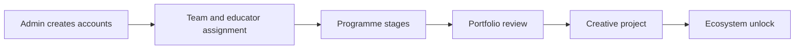

# IncluHub Dashboard

A role-based operations dashboard for IncluHub's creative-education programme. It replaces scattered sheets and chats with one controlled workflow for students, educators, external members, and administrators.

## What it covers

- Admin-created accounts and role-based dashboards.
- Student teams, institute and educator assignments, and programme stages.
- Portfolio submissions and educator/admin approvals.
- Brand or creative projects, studio QR check-in, notifications, and activity records.

## Core workflow



The security model is simple: an admin creates users; users never choose their own role; server-side checks and Supabase Row Level Security (RLS) limit each user to the data they are allowed to see.

## Stack

Next.js · React · TypeScript · Tailwind CSS · Supabase Auth, Postgres, Storage, and RLS · Vercel

## Run locally

1. Install dependencies and create local configuration:

   ```bash
   npm install
   cp .env.example .env.local
   ```

2. Set the Supabase values in `.env.local`. Keep `SUPABASE_SERVICE_ROLE_KEY` server-only and never commit secrets.

3. Apply the SQL migrations in order from `supabase/migrations/`, then start the app:

   ```bash
   npm run dev
   ```

Open `http://localhost:3000`.

## Verify

```bash
npm exec tsc -- --noEmit --incremental false
npm run lint
npm run build
npm run test:release-authz
```

More implementation detail is in [docs/README.md](docs/README.md) and [supabase/README.md](supabase/README.md).
